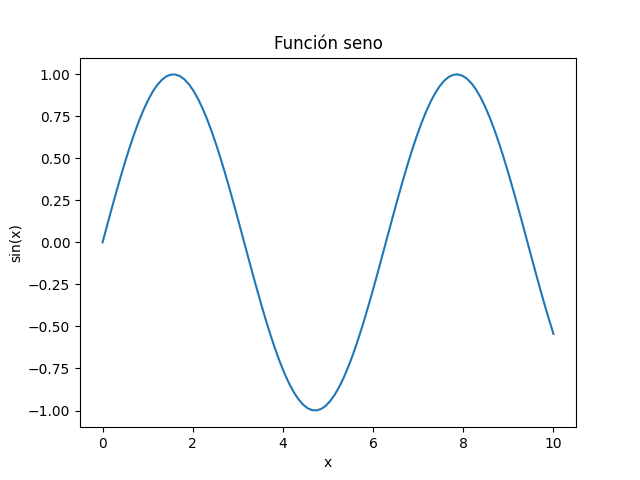

# Ejemplo 3: entorno con numpy y matplotlib

Genera un gráfico de la función seno. Este entorno no tiene pandas: solo `numpy` y `matplotlib`. En los entornos de los Ejemplos 1 y 2 este código daría `ModuleNotFoundError` por falta de matplotlib.

## Cómo ejecutarlo (Windows, PowerShell en VS Code)

```powershell
python -m venv venv
venv\Scripts\Activate.ps1
pip install -r requirements.txt
python main.py
```

En macOS/Linux: `python3 -m venv venv`, `source venv/bin/activate`.

En VS Code: `Ctrl+Shift+P` → **Python: Select Interpreter** → elegir `.\venv\Scripts\python.exe`.

## Resultado

No imprime nada: guarda `grafico_seno.png` en la carpeta del proyecto.


